<div align="center">

<picture>
  <source media="(prefers-color-scheme: dark)" srcset="docs/readme/banner-dark.svg">
  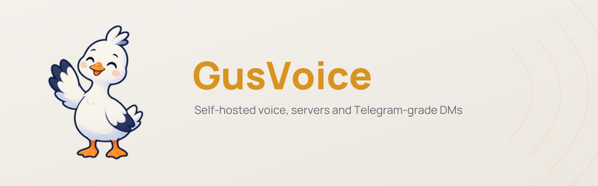
</picture>

# 🪿 GusVoice

**English** · [Русский](README.ru.md)

**Your own Discord — voice, screen sharing, servers and Telegram-grade direct messages — on your own server.**

One `docker compose` on a small VPS, no telemetry, every stream relayed by your server. Web, Windows and Android apps.

[](https://github.com/Gleb1290/gusvoice/releases/latest)
[](LICENSE)


[](https://boosty.to/glebbuster)

**[Install on your server →](#quick-start)**

[Why GusVoice](#why-gusvoice) · [See it in action](#see-it-in-action) · [Features](#features) · [Bots](#bots) · [Clients](#clients) · [Architecture](#architecture) · [Build from source](#build-from-source) · [Contributing](#contributing)

</div>

<p align="center">
  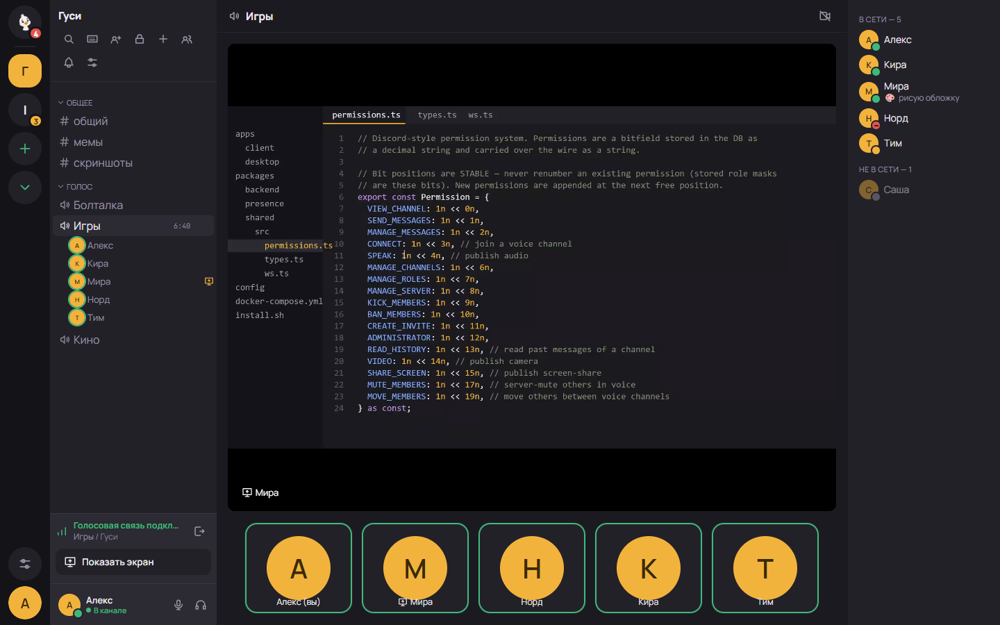
</p>

## Why GusVoice

GusVoice is a private place for a group of friends, a community or a small team: **servers → categories → text and voice
channels** with Discord-style roles, plus **direct messages that work like Telegram** — voice notes, round videos, polls,
calls, folders. It runs on a machine you control, and the apps talk only to it.

- **Nobody outside sees your traffic or your IP.** Every byte of audio, video and screen goes through a self-hosted
  [LiveKit](https://livekit.io) SFU — there is no peer-to-peer path, so nobody in the room learns anyone else's address.
  Messages, files and the map live on your disk; there is no telemetry.
- **Set up once, update with a button.** The installer asks a few questions, generates every secret and brings the stack up
  behind the bundled Caddy with Let's Encrypt. Later the admin panel shows when a new version is out and updates the server
  itself, with a database backup first.
- **Direct messages people will actually use.** Voice notes, round videos, albums, polls, calls, folders, drafts on every
  device, files up to 512 MB that resume after a drop — the Telegram set, not a chat bolted onto a voice app.
- **Voice that holds up in a game.** Noise suppression (RNNoise or DeepFilter), per-person volume, push-to-talk, global
  hotkeys; screen sharing up to 4K and 60 fps, hardware-encoded on Windows with application audio.
- **Grows with you.** Bots with a Telegram-style API, federation with a friend's server, push on Android without Google,
  an OpenStreetMap map served from your host — all optional, all in the same compose file.

## See it in action

<table>
  <tr>
    <td width="50%">
      <picture>
        <source media="(prefers-reduced-motion: reduce)" srcset="docs/readme/motion/voice.png">
        
      </picture>
      <br><sub>Voice channel: who is talking, per-person volume, mute and deafen</sub>
    </td>
    <td width="50%">
      <picture>
        <source media="(prefers-reduced-motion: reduce)" srcset="docs/readme/motion/dms.png">
        
      </picture>
      <br><sub>Direct messages and groups: replies, voice notes, polls, folders</sub>
    </td>
  </tr>
  <tr>
    <td width="50%">
      <picture>
        <source media="(prefers-reduced-motion: reduce)" srcset="docs/readme/motion/screenshare.png">
        
      </picture>
      <br><sub>Screen sharing: native resolution, the viewer picks the quality</sub>
    </td>
    <td width="50%">
      <picture>
        <source media="(prefers-reduced-motion: reduce)" srcset="docs/readme/motion/bots.png">
        
      </picture>
      <br><sub>Bots: a command menu on <code>/</code>, buttons under messages</sub>
    </td>
  </tr>
</table>

### Screenshots

<table>
  <tr>
    <td width="50%">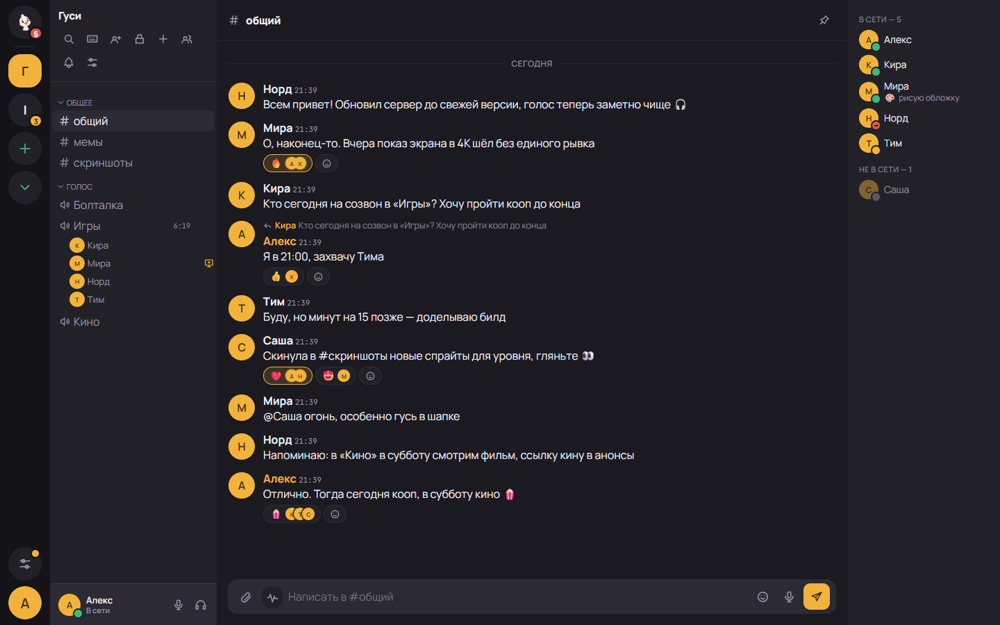<br><sub>Servers, channels and a live list of who is in voice</sub></td>
    <td width="50%">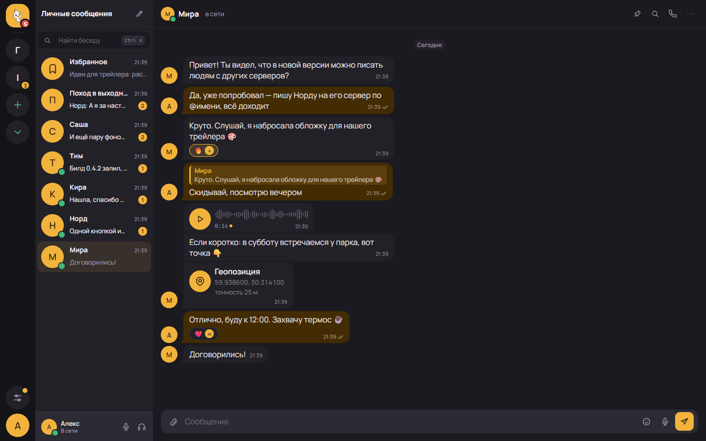<br><sub>Direct messages: replies, reactions, voice notes, location</sub></td>
  </tr>
  <tr>
    <td width="50%">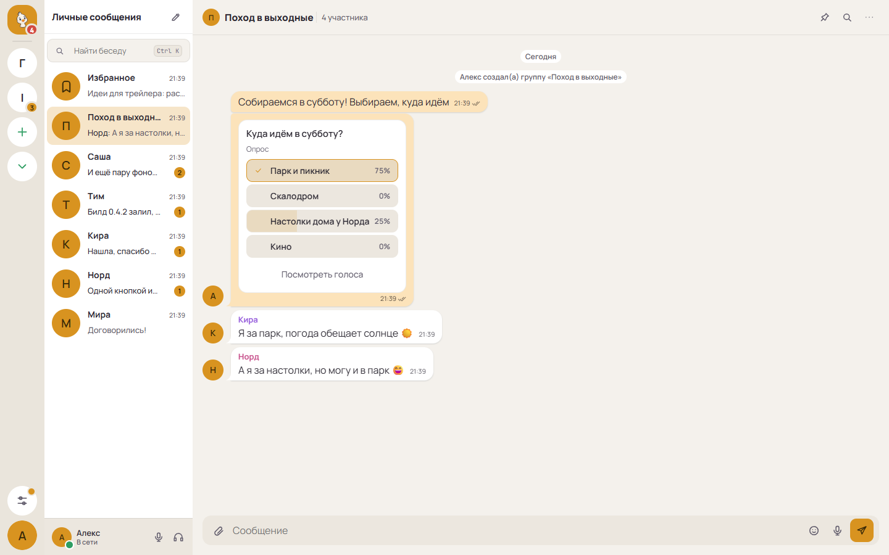<br><sub>Groups and polls — light theme</sub></td>
    <td width="50%">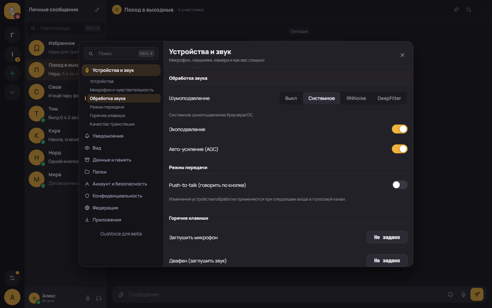<br><sub>Noise suppression: system, RNNoise or DeepFilter</sub></td>
  </tr>
</table>

<p align="center">
  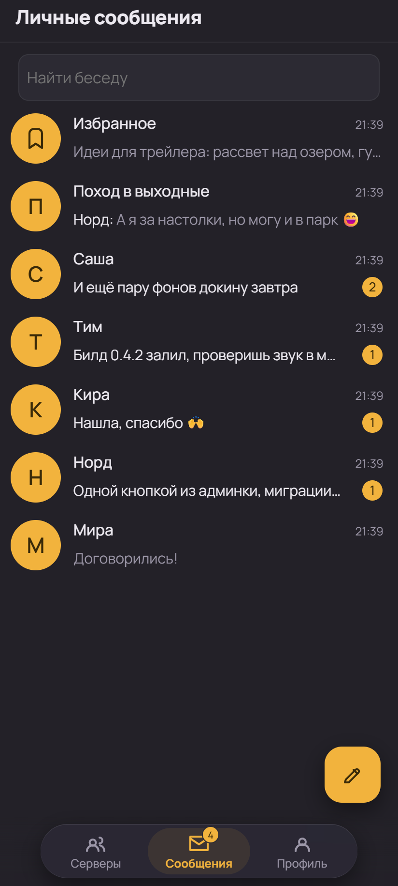
  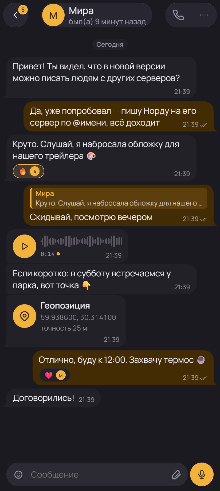
  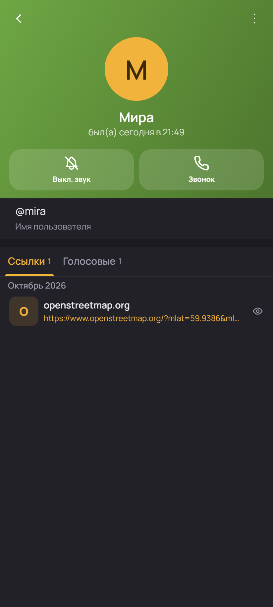
  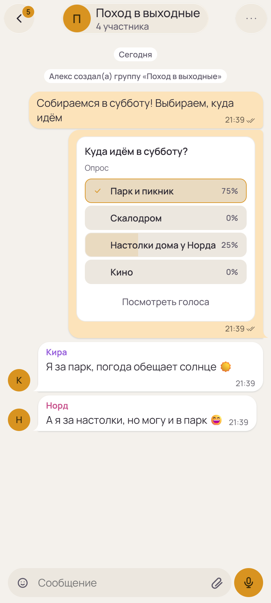
</p>

## Features

**🎙️ Voice and screen sharing**
- Voice channels with a live sidebar of who is talking; per-person volume, push-to-talk, global mute/deafen hotkeys on desktop.
- Noise suppression — system, **RNNoise** or **DeepFilter** — plus echo cancellation and auto-gain.
- Screen sharing in native resolution up to 4K, 15/30/60 fps, "Sharpness" or "Smoothness"; viewers pick the quality they receive.
- On Windows the share is native and hardware-encoded (NVENC), carries application audio, and the app stops redrawing while a game covers it.
- All media is relayed by the server — no P2P, no exposed IPs.

**🏠 Servers, channels, roles**
- Servers → categories → text and voice channels; invite links with expiry and use limits.
- Discord-style roles and permissions with per-category and per-channel overrides; voice moderation; audit log.
- Replies, reactions, @mentions (including `@everyone`), pins, attachments, search, custom emoji and per-server sounds.
- Optional extras: a per-server coin economy with a shop and soundboard, "Playing …" status.

**💬 Direct messages, the Telegram way**
- Bubbles, albums of up to 10 photos and videos, replies to a fragment, forwarding to several chats, pinned messages and chats.
- Voice notes up to 30 minutes (1× / 1.5× / 2×, "listen once") and round video messages.
- One-to-one calls with voice, video and screen sharing; on Android an incoming call opens full screen even when locked.
- Groups, Saved Messages, polls and quizzes, location and live location, contacts, files up to 512 MB that resume after a drop.
- Folders and archive, drafts on every device, "send later" and "send when online", silent send, mute for any period.
- Instant start from the on-device cache; unsent messages go out by themselves when the network is back.
- Privacy: who sees your last-seen time, who may message and call you, a stranger bar with Report and Block.

**🤖 Bots** *(off by default)* — a Telegram-style Bot API with SDKs for TypeScript and Python; bots answer in DMs, work on servers and play audio in voice channels. Details in [Bots](#bots).

**🌐 Federation** *(off by default)*
- Link your server with a friend's: both admins approve, each instance signs its requests with its own key.
- People from the other server join yours with **their own account** via an invite link; all their servers sit in one sidebar.
- Direct messages between servers (`@name@server`), including groups, calls and files; a conversation keeps going if one side is down.

**📱 Clients**
- Web app, auto-updating **Windows** desktop app (tray, global hotkeys, notifications in the style of Telegram Desktop) and **Android**.
- You type your server's address at sign-in and can switch between servers at any time.

**🗺️ Own map** — locations in DMs are drawn from an OpenStreetMap extract on *your* server; clients never call third-party map services. See [docs/maps.md](docs/maps.md).

**🔔 Push without Google** — DMs and mentions wake the Android app through [UnifiedPush](https://unifiedpush.org) and the bundled [ntfy](https://ntfy.sh) gateway — no Firebase, no Google Play Services.

**🔄 One-click updates** — the admin panel tells you when a new version is out; the **Update** button backs up the database and updates the server — no console, no SSH. The Windows and Android apps update themselves.

**🔒 Secure by default** — secrets generated at install, fail-closed config, rate-limited sign-in, optional 2FA, sign-up policy (open, approval or invite-only).

## Bots

A bot is an account driven by a program. It signs in with a token and talks to the server over plain HTTP — `curl`, Python,
Node, anything. The API follows Telegram's Bot API, so code and habits carry over: `sendMessage`, `getUpdates`,
`answerCallbackQuery`, `inline_keyboard`.

- **Where a bot works.** In **direct messages** (it never writes first — a person presses **Start**), on **servers** (posts to
  text channels, answers commands, reacts, moderates; gets its own role whose permissions never exceed the admin who added it)
  and in **voice channels**, where it **plays audio and never hears people** — the server issues it a LiveKit token without
  subscribe rights.
- **Buttons and menus.** Inline buttons under messages (`reply_markup` → `callback_query`), a command menu on `/` with
  separate lists for DMs and servers, cards (`embeds`), reactions, HTML text formatting.
- **How events arrive.** Long polling (`getUpdates`), a WebSocket, or signed delivery to your URL (HMAC-SHA256, optional
  batches of up to 100 updates). One consumer per token, as in Telegram.
- **API versions.** The current server reports `api_version` 4: 2 — buttons and commands, 3 — servers, 4 — voice.
  `getMe.features` lists what the instance supports, so a bot can check capabilities instead of guessing. Every instance
  serves its schema at `/api/bot/v1/openapi.json` and an AI-ready reference at `/api/bot/v1/llms.txt`.
- **Off by default.** The super-administrator turns bots on in the admin panel; until then tokens are rejected and nobody
  can create one.

**SDKs** — on npm and PyPI:

| Package | Where | Install |
|---------|-------|---------|
| `@gusvoice/bot` — TypeScript, zero dependencies (Node.js 22+, Bun, Deno); voice via `@gusvoice/bot-voice` | [`packages/bot-sdk`](packages/bot-sdk), [`packages/bot-voice`](packages/bot-voice) | `npm i @gusvoice/bot` (voice: `npm i @gusvoice/bot-voice`) |
| `gusvoice-bot` — Python 3.9+, standard library only | [`packages/bot-sdk-py`](packages/bot-sdk-py) | `pip install gusvoice-bot` (or copy `gusvoice_bot/` next to your bot) |

```ts
import { Bot } from '@gusvoice/bot';

const bot = new Bot(process.env.GUSVOICE_BOT_TOKEN!, { baseUrl: 'https://voice.example.com' });

bot.command('status', (ctx) => ctx.reply(`args: ${ctx.args.join(' ')}`));
bot.on('message', (ctx) => ctx.reply(`echo: ${ctx.text}`));

await bot.start(); // WebSocket; bot.start({ mode: 'polling' }) for long polling
```

Ready-made bots under the MIT licence in [`examples/bots`](examples/bots): an echo bot, delivery to a URL, a VPS control
panel with buttons, a server moderator, a music bot, a one-line `curl` notification, Python equivalents, a systemd unit and
a Dockerfile.

- **[docs/bots.md](docs/bots.md)** — the full reference: objects, methods, events, limits, differences from Telegram.
- **[docs/bots-playbook.md](docs/bots-playbook.md)** — a step-by-step guide to building a bot with an AI assistant, for people who do not write code.
- **[docs/bots-llm.md](docs/bots-llm.md)** — the file to paste into an AI assistant.

## Quick start

You need:

- a **Linux host** — a small VPS is fine (2 vCPU / 4 GB RAM / 20 GB disk to start);
- a **domain** you control — GusVoice uses six sub-domains: `voice` · `api` · `presence` · `lk` · `media` · `ntfy`;
- open ports **80** and **443**, plus LiveKit media **7881/tcp** and **7882/udp**;
- **Docker** — the installer offers to install it if it's missing.

```bash
curl -fsSL https://raw.githubusercontent.com/Gleb1290/gusvoice/main/install.sh | bash
```

Prefer to read before running?

```bash
git clone https://github.com/Gleb1290/gusvoice.git
cd gusvoice
./install.sh
```

The installer asks a few questions, **generates every secret**, writes `.env` and brings the stack up behind the bundled
Caddy with automatic Let's Encrypt HTTPS — or behind the reverse proxy you already run (Nginx Proxy Manager, nginx, Traefik;
it asks). It finishes by printing the exact **DNS records** and **port forwards** to set up.

Then open `https://voice.<your-domain>` and enter the **setup code** the installer printed: a short web wizard creates your
admin account and sets the server name, e-mail, who may register and a first server with an invite link.

Full walkthrough — DNS, your own proxy, connecting the apps — in **[docs/SELF-HOSTING.md](docs/SELF-HOSTING.md)**.

## Clients

| Platform | How to get it |
|----------|---------------|
| **Web** | `https://voice.<your-domain>` — nothing to install |
| **Windows** | installer from **[Releases](https://github.com/Gleb1290/gusvoice/releases/latest)**; updates itself |
| **Android** | APK from **[Releases](https://github.com/Gleb1290/gusvoice/releases/latest)**; background voice, full-screen calls, push via UnifiedPush |

Launch the app and type your server's address (for example `voice.example.com`). More servers can be added later in
**Settings → Federation → My instances**. Desktop details: [apps/desktop/README.md](apps/desktop/README.md).

## Architecture

<picture>
  <source media="(prefers-color-scheme: dark)" srcset="docs/readme/architecture-dark.svg">
  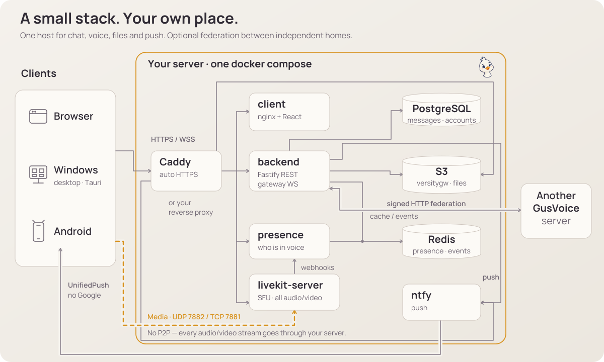
</picture>

- **backend** (Node.js, Fastify, Drizzle/PostgreSQL) — accounts, servers, channels, roles, messages and DMs, the real-time gateway, the Bot API and the **LiveKit tokens**: what you may publish is decided by your permissions.
- **livekit-server** — the SFU; voice, video and screen shares all flow through it (`7882/udp`, `7881/tcp` fallback). There is no P2P mode.
- **presence** — receives LiveKit webhooks and tells every client who is in which voice channel.
- **client** — the React web app; the Windows (Tauri) and Android apps wrap the same code.
- **PostgreSQL** + **Redis** for data and fan-out, **versitygw** for uploads (S3 API), **ntfy** for push, **Caddy** for TLS.

How the pieces fit together in detail: **[docs/ARCHITECTURE.md](docs/ARCHITECTURE.md)**.

## Update

**From the admin panel — the main way.** The **Instance** tab shows the installed and the newest version; the **Update**
button backs up the database and updates the server step by step, with progress right in the panel. The installer enables the
button by itself when it runs as root or with password-less `sudo`; otherwise it prints one command at the end —
`sudo ./update.sh --install-updater`. The backend never gets access to Docker: it leaves a request that a small systemd
watcher on the host picks up. The desktop and Android apps update themselves.

**From the console** — the same thing in one command:

```bash
cd gusvoice
./update.sh
```

`update.sh` backs up your `docker-compose.yml` and `config/`, refreshes them to the latest release, pulls the new images,
**saves a copy of the database** into `./.gusvoice-backups/` and recreates only the containers that changed. Your `.env` and
data are left alone; database migrations run by themselves on start.

| Flag | Effect |
|------|--------|
| `--images-only` | Only pull images and recreate — don't touch `docker-compose.yml` / `config/`. |
| `--prune` | Remove old dangling images afterwards. |
| `--no-db-backup` | Skip the database copy. |
| `--install-updater` | (root, systemd) Enable the **Update** button in the admin panel. |
| `-y`, `--yes` | Non-interactive. |

## Uninstall

```bash
./uninstall.sh            # stop and remove the containers — your data is kept
./uninstall.sh --purge    # asks you to type "yes", then deletes data volumes and .env
```

## Where things live

| What | Where |
|------|-------|
| Config and **all secrets** | `.env` (written by the installer, `chmod 600` — never commit it) |
| Database, uploads, push and TLS state | Docker named volumes (`gusvoice_pgdata`, `gusvoice_s3data`, `gusvoice_ntfydata`, `gusvoice_caddydata`, …) |
| Proxy and SFU config | `config/Caddyfile`, `config/livekit.yaml` (driven by `.env`) |
| Update backups | `./.gusvoice-backups/<timestamp>/` |

## Build from source

Prebuilt images are the default, but the compose file has a `build:` section for every service:

```bash
git clone https://github.com/Gleb1290/gusvoice.git && cd gusvoice
./install.sh                 # generates .env and starts the stack
docker compose build         # build the images from this source
docker compose up -d
```

Working on the code itself (Node.js, pnpm, typecheck, tests, the desktop app with Rust) — see **[CONTRIBUTING.md](CONTRIBUTING.md)**.

```
packages/shared      permission bitfield, DTO types, WebSocket protocol
packages/backend     REST + gateway + Bot API + LiveKit tokens (Fastify, Drizzle)
packages/presence    LiveKit webhooks → Redis → presence WebSocket
packages/bot-sdk     Bot API SDK for TypeScript (+ bot-voice for audio in voice channels)
packages/bot-sdk-py  Bot API SDK for Python
apps/client          React web app (also inside the desktop and Android apps)
apps/desktop         Tauri v2 shell for Windows and Android
examples/bots        ready-made bots (MIT)
config/              LiveKit and Caddy config (no secrets)
docker-compose.yml   the whole stack
```

## Contributing

Bug reports, fixes and translations are welcome, in **English or Russian** — start with **[CONTRIBUTING.md](CONTRIBUTING.md)**.
Before your first pull request is merged you'll be asked to accept the **[CLA](CLA.md)** ([why](LICENSING.md)). Found a
security problem? Report it privately — see **[SECURITY.md](SECURITY.md)**, never in a public issue.

If GusVoice is useful to you, you can support development on **[Boosty](https://boosty.to/glebbuster)** — it pays for servers
and build hardware. Thank you 🪿

## License

**[AGPL-3.0-only](LICENSE)** — free to use, self-host and modify. If you run a modified GusVoice as a service for other people,
you must offer them your changes under the same licence. Third-party components, the NVIDIA Video Codec SDK exception and the
reasoning behind the CLA are in **[LICENSING.md](LICENSING.md)**.
